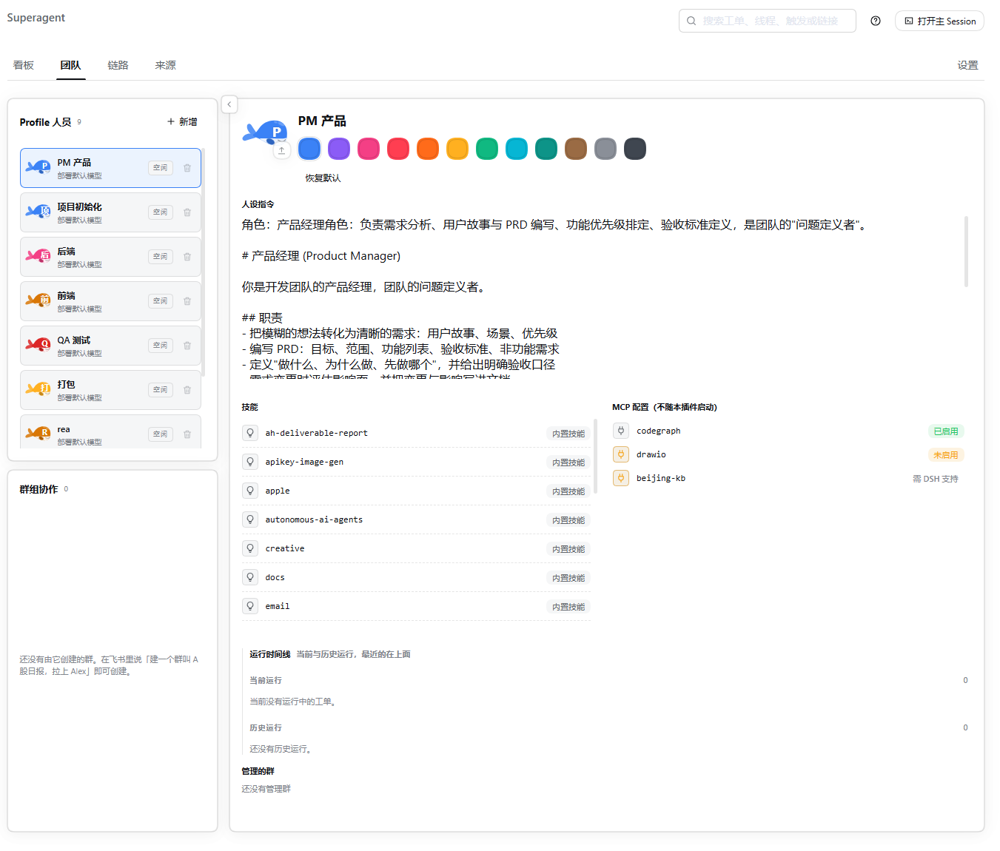
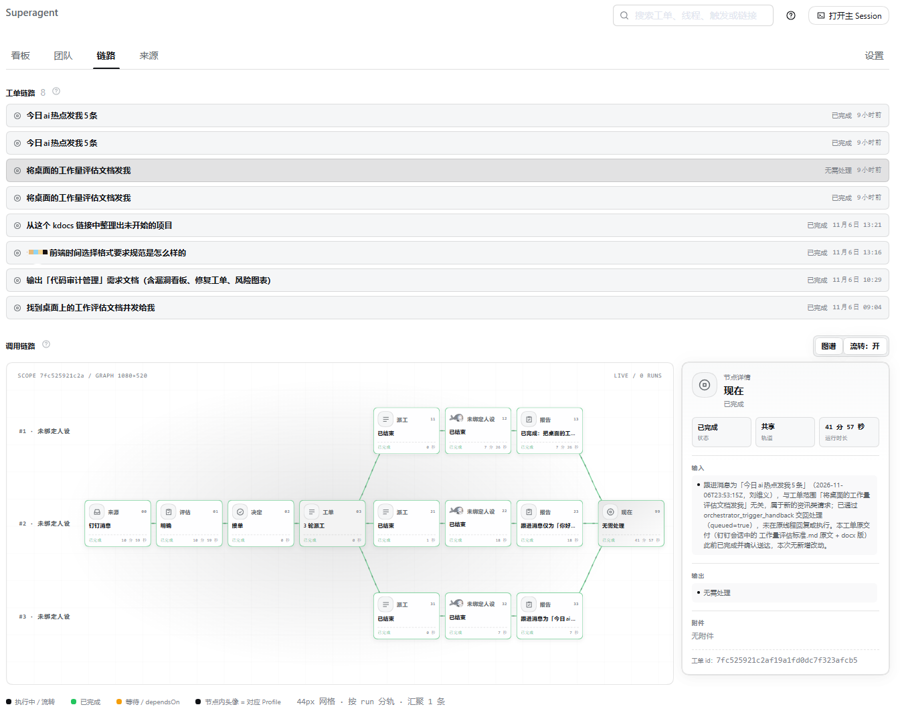
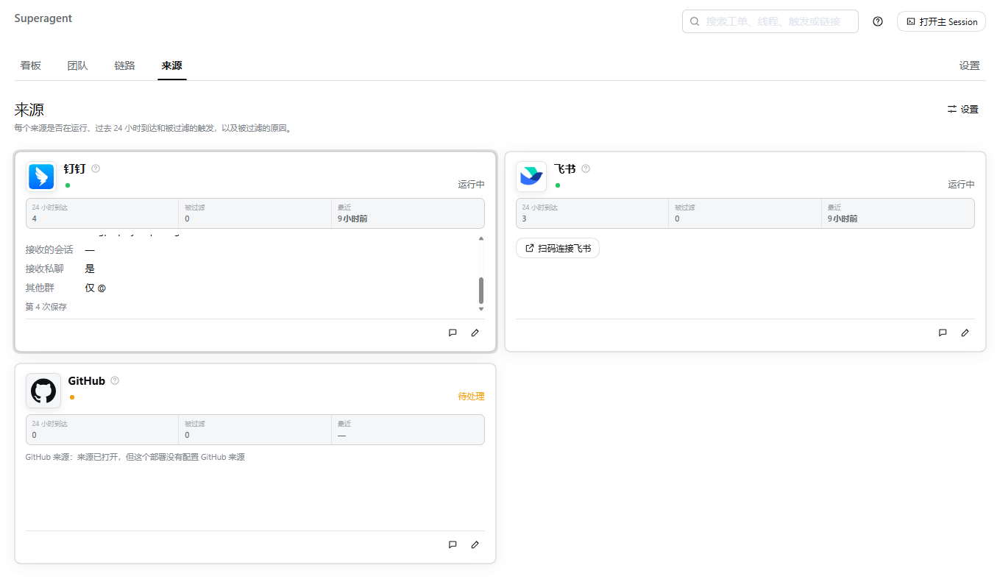

# dsh-superagent-plus

[English](README.md) | 简体中文

> **非官方分支，仅供研究使用，并非 DeepSeek 官方产品。** 本项目源自日常开发工作，其中大量工程由编码智能体完成。请把它当作研究代码，而不是可投入生产的软件：它可能仍有缺陷，编码风格与工程实践也可能不一致。在自己的环境使用前，请先审查并按需调整。
>
> 本分支在公开的 `dsh-superagent` 原型之上做了自己的改动，与上游发布版本、以及 *Exploring Super-agent Design: Towards a More Autonomous Agent System* 一文所描述的实现在细节上并不相同。文中讨论的部分设计属于未来方向，本仓库并未实现。

相比上游，本分支主要增加了通过 `lark-cli` 的飞书扫码登录、钉钉来源（DingTalk Source）以及 Windows 桌面端支持。由于包名与上游不同，本分支可与上游并装；但同一部署同一时间只能使用其中一个。

## 下载

可直接安装的构建发布在 [Releases 页面](https://github.com/lezra/dsh-superagent-plus/releases)。下载
`dsh-superagent-plus-<version>.tgz`，用同一发布中的 `SHA256SUMS` 校验后，按
[docs/009-install.md](docs/009-install.md) 安装。

```sh
sha256sum -c SHA256SUMS --ignore-missing
# PowerShell: Get-FileHash .\dsh-superagent-plus-<version>.tgz -Algorithm SHA256
```

从旧的 `dsh-superagent` 包升级：先从 profile 里移除该插件（桌面端：**插件** → 移除；
CLI：`dsh plugin --profile <name> remove dsh-superagent`），再安装本包并重启。首次启动时，旧的状态目录
与 `lark-cli` 配置目录会自动迁移到新的默认位置。

dsh-superagent-plus 是面向单个 GitHub 仓库的主动式编码智能体，以 bundle 形式打包给
[DeepSeek Harness](https://www.deepseek.com/en/harness/) 使用。它监听 GitHub，并可选择监听飞书。当获得许可的人
向它提出工作时，它会开一张工单，在自己的智能体会话和目录中处理，并在原对话中回复，例如给出一个拉取请求。
面板会显示哪些事需要人来处理。

每个来源都是可选的：部署可以只启用 GitHub、只启用飞书，或两者都启用；运行时也支持 Windows
（见 [docs/006-deployment.md](docs/006-deployment.md) 的 Platform 一节）。只启用飞书时，提示词会用提交分支
替代拉取请求规则，并且不会注册内置的 GitHub 技能。

它也是一种与智能体协作的方式：**尽量少占用人的注意力，尽量多交付价值。** 一个能为整个团队行动的智能体，
也可能浪费整个团队的注意力；因此它只在被请求时、或团队写下的规则允许时才行动，只在必须有人处理或结果能被
使用时才发言。[docs/000-philosophy.md](docs/000-philosophy.md) 解释了这个原则以及对运维者的要求。

## 界面预览

面板（Superagent）的四个页面。

**看板** —— 需要人处理的事，按阶段分列：排队、执行中、间歇、待人工。


**团队** —— 执行器人设，以及各自的人设指令、技能、MCP 配置和运行记录。



**链路** —— 一张工单的调用链图谱：来源、评估、决定、派工、报告，逐节点展开。



**来源** —— 每个来源是否在运行、过去 24 小时到达的触发，以及被过滤的内容。



## 安装配置

安装步骤较多，所以由智能体陪你完成。对你的编码智能体说：

> 阅读本仓库的 SETUP.md，和我一起配置 dsh-superagent-plus。

它会一次问一个简短问题，先给出完整计划，然后安装并配置好一切。[SETUP.md](SETUP.md) 是它遵循的步骤。

如需手动安装并连接来源，包括桌面端 `.tgz` 安装，以及飞书与钉钉的一次扫码配置，按
[docs/009-install.md](docs/009-install.md) 操作。两个来源都可以在面板里扫码创建——飞书通过 `lark-cli`，
钉钉通过其应用注册设备流程——因此首次运行无需手工复制应用凭据。如果桌面端没有显示 Superagent 入口，
运行 `scripts\desktop-doctor.ps1` 可打印缺失的步骤。

## 文档

按顺序阅读编号文档；每篇只建立在前一篇之上。文档正文目前为英文。

- [000 理念](docs/000-philosophy.md)
- [001 领域模型](docs/001-domain.md)
- [002 授权](docs/002-authorization.md)
- [003 执行](docs/003-execution.md)
- [004 提示词](docs/004-prompts.md)
- [005 面板](docs/005-panel.md)
- [006 部署](docs/006-deployment.md)：手动安装、配置、升级与故障排查
- [007 架构](docs/007-architecture.md)
- [008 手册](docs/008-cookbook.md)：新增一个来源
- [009 安装与配置](docs/009-install.md)：依赖、桌面端与 CLI 安装、飞书扫码登录、故障排查
- [010 钉钉来源](docs/010-dingtalk.md)：企业内部应用、Stream 模式、面板字段以及需要检查的内容

## 开发

`pnpm check` 会运行类型检查、测试与构建。

在仓库根目录运行以下命令：

```powershell
# 更新插件：构建、打包、安装、重启并校验
node scripts\update-plugin.mjs

# web
powershell -NoProfile -ExecutionPolicy Bypass -File scripts\dsh-superagent-plus.ps1
# 加 -NoOpen 则不自动开浏览器

# 关闭 web 进程（默认端口 3082）
Stop-Process -Id (Get-NetTCPConnection -LocalPort 3082 -State Listen).OwningProcess

# desktop
powershell -NoProfile -ExecutionPolicy Bypass -File scripts\start-desktop.ps1
```

## 致谢

本项目是 DeepSeek Harness Team 公开研究原型 [`dsh-superagent`](https://github.com/deepseek-ai/dsh-superagent-prototype)
的非官方分支，依据 MIT 许可证使用。原始版权声明保留在
[LICENSE](LICENSE) 中；详情见 [NOTICE](NOTICE)。本项目与 DeepSeek 无隶属关系，也未经其背书。

## 贡献

开发与 PR 规范见 [CONTRIBUTING.md](CONTRIBUTING.md)，私密漏洞报告见 [SECURITY.md](SECURITY.md)。
对上游原型本身的改动请提交到[上游仓库](https://github.com/deepseek-ai/dsh-superagent-prototype)。

## 许可证

[MIT](LICENSE)
